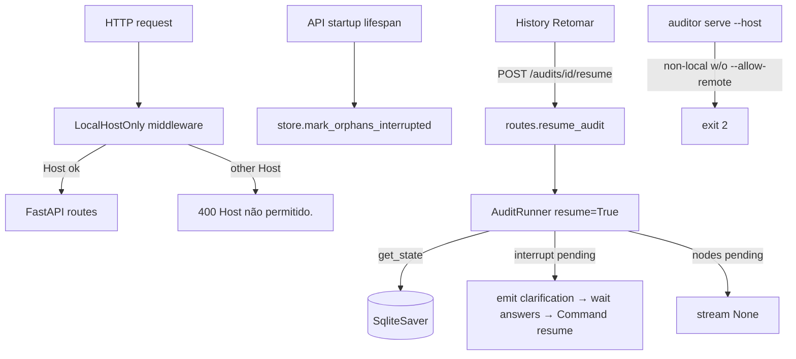

# API Hardening Design

**Spec**: `.specs/features/api-hardening/spec.md` · **Context**: decisions in the spec's Assumptions table (all four gray areas answered by the user)
**Status**: Approved

## Approaches considered (resume)

| Approach | Summary | Trade-off |
| -------- | ------- | --------- |
| **A. State-driven resume in `AuditRunner` (recommended)** | `AuditRunner(..., resume=True)` inspects `graph.get_state()` and picks the first input (re-ask / `None`). Same `_drive` loop, same SSE log. | Small change to one class; no new persistence. |
| B. Persist the pre-crash status | New column `previous_status`; resume branches on it. | Schema change; can disagree with the checkpoint (the real source of truth). |
| C. New `ResumeRunner` subclass | Separate class. | Duplicates the finalize/error handling. |

## Architecture

## Components

| Component | Location | Interface | Reuses |
| --------- | -------- | --------- | ------ |
| `LocalHostOnlyMiddleware` | `src/auditor/api/security.py` (new) | ASGI middleware; `parse_host(header) -> str`; `allowed_hosts(extra: str) -> frozenset[str]` | — |
| `allowed_hosts` setting | `config.py` | `AUDITOR_ALLOWED_HOSTS` (comma-separated) | `Settings` |
| Wiring + lifespan | `api/main.py` | `lifespan` → `get_store().mark_orphans_interrupted()` | `deps.get_store` |
| `AuditStore.mark_orphans_interrupted() -> int` | `api/store.py` | UPDATE status where status ∈ {started, running, waiting_input} | store lock pattern |
| `AuditRunner(resume=True)` | `api/runner.py` | `_first_input()` from state | `_drive`, finalize block |
| `POST /audits/{id}/resume` | `api/routes.py` | 200/400/404/409 | `get_llm` validation as in `create_audit`, `_summary` |
| Bind guard | `cli.py serve` | `--allow-remote` | — |
| UI | `History.tsx`, `client.ts`, `App.tsx` | `onResume`, `resumeAudit(id)` | `openStream`, `jsonOrThrow` |

## Error Handling

| Scenario | Handling | User impact |
| -------- | -------- | ----------- |
| Foreign `Host` | 400 plain text, route not run | Rebinding page gets nothing |
| Resume unknown / not interrupted / live | 404 / 409 | Message in UI |
| Resume with bad provider config | 400 (`LLMConfigError` text); status unchanged | Fix `.env`, retry |
| Non-local bind without flag | exit 2 + explanation | Nothing exposed |

## Risks & Concerns

| Concern | Location | Impact | Mitigation |
| ------- | -------- | ------ | ---------- |
| Starlette `TrustedHostMiddleware` mis-parses IPv6 | starlette 1.3.1 `trustedhost.py` (`split(":")[0]`) | `[::1]` clients rejected | Own middleware with bracket-aware parsing (HOST-01 test). |
| Existing `TestClient` uses `Host: testserver` | `tests/test_api.py:9` | Suite would 400 | `base_url="http://localhost"`; no assertion change (logged in spec). |
| `--reload` restarts the process | `cli.py serve` | Live audits die on reload | Exactly what ORPH-01 reconciles; documented. |
| Resume re-runs a node from its start | LangGraph semantics | Token cost of the interrupted node repeats | On-demand only (user decision); documented. |
| Runner status during resume | `api/runner.py:96-100` | Must set `waiting_input` before waiting | RES-01 asserts status updates. |

## Tech Decisions

| Decision | Choice | Rationale |
| -------- | ------ | --------- |
| Resume approach | A (state-driven) | Checkpoint is the source of truth. |
| Middleware | Own ASGI | IPv6 correctness. |

Project-level: **AD-002** — the local API only answers loopback `Host`s; any non-local exposure is explicit opt-in (`--allow-remote` + `AUDITOR_ALLOWED_HOSTS`).
