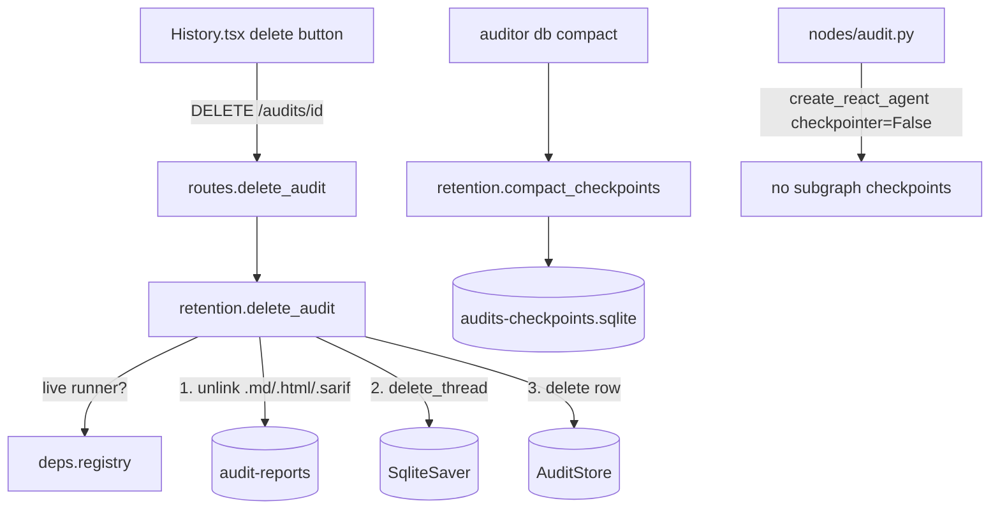

# Audit Retention Design

**Spec**: `.specs/features/audit-retention/spec.md`
**Status**: Approved

## Approaches considered

| Approach | Summary | Trade-off |
| -------- | ------- | --------- |
| **A. Retention module (recommended)** | New `auditor/api/retention.py` with `delete_audit(...)` and `compact_checkpoints(...)`; the route and the CLI stay thin. | One new module; pure functions with injected store/checkpointer/registry → unit-testable without the app or the real home dir. |
| B. Logic in the route + CLI | Deletion inside `routes.py`, compaction inside `cli.py`. | Fewer files, but logic only testable through HTTP/CLI and duplicated knowledge of the schema. |
| C. Extend `AuditStore` | Store also deletes checkpoints and files. | Mixes metadata persistence with checkpointer and filesystem concerns. |

## Architecture Overview

## Code Reuse Analysis

| Component | Location | How to Use |
| --------- | -------- | ---------- |
| `SqliteSaver.delete_thread` | langgraph-checkpoint-sqlite 3.1 | Removes checkpoints + writes of all namespaces of a thread (verified in source). |
| `create_react_agent(checkpointer=False)` | langgraph-prebuilt 1.1 | `False` disables checkpointing even under a parent checkpointer (verified in `langgraph/types.py` docs). |
| `AuditStore` lock + connection | `api/store.py` | New `delete(audit_id)` follows `update()`'s pattern. |
| `build_checkpointer`, `CHECKPOINT_DB` | `api/store.py` | Compaction targets the same path; `get_checkpointer()` singleton shared by the graph and the route. |
| `jsonOrThrow` | `frontend/src/api/client.ts` | Error detail extraction for `deleteAudit` (204 has no body → small variant). |
| Typer app | `cli.py` | New `db` sub-app with `compact`. |

## Components

### `auditor/api/retention.py` (new)
- `class AuditBusyError(Exception)`, `class AuditNotFoundError(Exception)`
- `delete_audit(audit_id, store, checkpointer, registry) -> None` — raises NotFound/Busy; order: files → `checkpointer.delete_thread` → `store.delete` → `registry.pop`. File removal: only recorded `report_html/report_md/report_sarif` with allowed suffix; `FileNotFoundError` ignored; other `OSError` propagates (nothing else touched yet).
- `@dataclass CompactStats(removed_checkpoints, removed_writes, size_before, size_after)`
- `compact_checkpoints(db_path: Path, timeout: float = 1.0) -> CompactStats` — `DELETE … WHERE checkpoint_ns != ''` on both tables, commit, `VACUUM`; `sqlite3.OperationalError` propagates (CLI maps "locked" to exit 1). Size = main file + `-wal`.

### `api/store.py` (modify)
- `AuditStore.delete(audit_id) -> None`.

### `api/deps.py` (modify)
- `get_checkpointer()` (lru_cache) → used by `get_graph()` and the route.

### `api/routes.py` (modify)
- `DELETE /audits/{audit_id}` → 204 / 404 / 409 / 500 (`HTTPException` with Portuguese `detail`, matching existing routes).

### `cli.py` (modify)
- `db_app = typer.Typer()`; `app.add_typer(db_app, name="db")`; `compact` command.

### `nodes/audit.py` (modify)
- `create_react_agent(llm, tools=tools, prompt=prompt, checkpointer=False)`.

### Frontend
- `api/client.ts`: `deleteAudit(id): Promise<void>`.
- `components/History.tsx`: `onDelete(a)` prop, per-row delete → inline confirm/cancel; row's open button and delete controls are siblings (no nested buttons).
- `App.tsx`: `handleDeleteAudit` → refresh history, show error in `startError`.

## Error Handling Strategy

| Error Scenario | Handling | User Impact |
| -------------- | -------- | ----------- |
| Unknown id | 404 `Auditoria não encontrada.` | Message in UI |
| Live audit | 409 `Auditoria em execução; aguarde a conclusão para excluir.` | Message in UI |
| Report unlink fails (permission) | 500 with detail; metadata/checkpoints kept | Can retry |
| DB locked during compact | exit 1, "pare a API (auditor serve) e tente novamente" | Clear instruction |

## Risks & Concerns

| Concern | Location | Impact | Mitigation |
| ------- | -------- | ------ | ---------- |
| Store creates `~/.config/auditor` + DB at import time | `api/store.py:14-21` | Tests touch the real user dir | New tests inject tmp stores/savers; route tests monkeypatch `routes.get_store`/`get_checkpointer`. Import side effect itself left as-is (out of scope; noted). |
| Sub-agent opt-out relied on ThreadPoolExecutor not copying context | `nodes/audit.py:75` | Silent regression → GBs of checkpoints | `checkpointer=False` + SUB-01 test that runs the investigator in the parent's context. |
| Report paths are absolute and resolved at write time from `AUDITOR_OUTPUT_DIR` | `nodes/report.py:14` | Moving the reports dir leaves stale paths | Missing files are tolerated (RET-06). |
| No component tests exist in the frontend | `frontend/src/components` | UI regressions unnoticed | Add a Testing Library test for `History` (deps already installed). |

## Tech Decisions

| Decision | Choice | Rationale |
| -------- | ------ | --------- |
| Where retention logic lives | `auditor/api/retention.py` | Approach A — testable, single responsibility. |
| Live vs orphan | registry + `done` flag | Only source of truth for liveness in-process. |

**Project-level decision** recorded in `.specs/STATE.md` as AD-001 (sub-agents never checkpoint).
