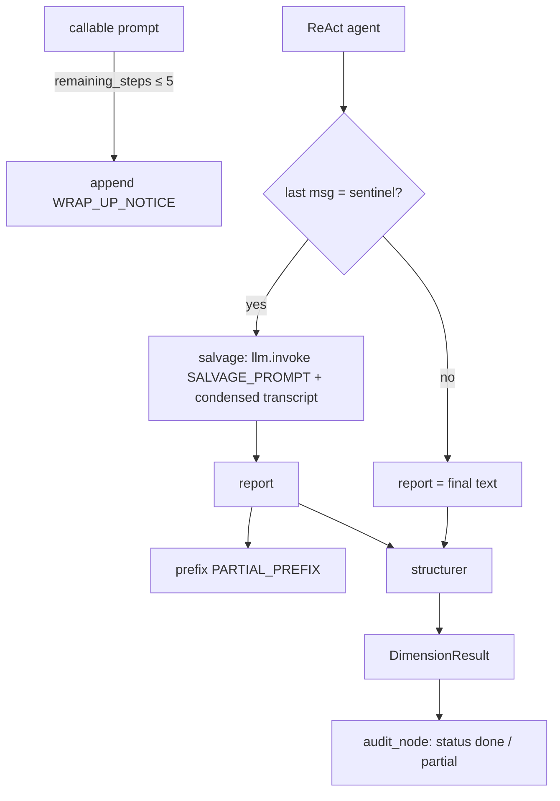

# Investigator Budget Design

**Spec**: `.specs/features/investigator-budget/spec.md` · **Status**: Draft
Active decisions honored: AD-001 (sub-agents keep `checkpointer=False`).

## Approaches (wrap-up notice)

| Approach | Trade-off |
| -------- | --------- |
| **A. Callable `prompt` reading `remaining_steps` (recommended)** | Runs inside the agent node — no extra steps (verified: same 4 tool calls at limit 10). |
| B. `pre_model_hook` | Extra node per loop → ~1/3 fewer tool calls for the same limit. |
| C. Only salvage | Always pays one extra call on exhaustion; agent never gets a chance to conclude itself. |

## Flow

## Components

| Component | Location | Interface |
| --------- | -------- | --------- |
| `content_text(content) -> str` | `src/auditor/nodes/_messages.py` (new) | str or list of blocks → text; reused by `audit._final_report` and `synthesis_node` |
| `WRAP_UP_NOTICE`, `SALVAGE_PROMPT` | `prompts/templates.py` | prompt constants (pt-BR, like the others) |
| `_make_prompt(system: str) -> Callable[[state], list]` | `nodes/audit.py` | system first, then messages, notice when `remaining_steps ≤ _WRAP_UP_AT` |
| `_budget_exhausted(messages) -> bool`, `_condensed_transcript(messages) -> str`, `_salvage_report(llm, dimension, messages) -> str` | `nodes/audit.py` | per spec bounds |
| `PARTIAL_PREFIX`, `is_partial(dr)` | `nodes/audit.py` | flag via summary prefix (keeps `_investigate_dimension -> DimensionResult | None`, so existing mocks stay valid) |
| `partial` status | `audit_node`, `frontend/src/types.ts`, `Timeline.tsx` | event + UI label |

## Risks & Concerns

| Concern | Location | Mitigation |
| ------- | -------- | ---------- |
| Sentinel string is an upstream implementation detail | `langgraph/prebuilt/chat_agent_executor.py:689,716` | Test runs the real prebuilt; failure surfaces on upgrade (and G44 will revisit). |
| Salvage transcript could exceed context | — | Per-item and total caps (spec BUD-02). |
| Partial flag encoded in summary text | `audit.py` | Single constant + `is_partial()`; summary prefix is also the user-visible flag (BUD-03). |
| `create_react_agent` deprecated (G44) | `nodes/audit.py` | Out of scope; callable `prompt` exists in both APIs. |

## Tech Decisions

| Decision | Choice | Rationale |
| -------- | ------ | --------- |
| Notice mechanism | Approach A | No budget loss. |
| Partial flag | Summary prefix + `is_partial` | No signature change; visible in every report format. |
