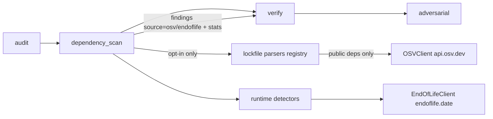

# Vulnerable Dependencies & Runtimes Design

**Spec**: `.specs/features/vuln-scan/spec.md` · **Status**: Draft
Active decisions honored: AD-001 (no sub-graph checkpoints — the new node is a plain node), AD-002 (loopback API — unchanged). New: **AD-003** (below).

## Approaches
| | Approach | Trade-off |
| - | -------- | --------- |
| **A (chosen)** | Deterministic `dependency_scan` node; parsers/sources behind small protocols; HTTP clients injected | Zero tokens, reproducible, unit-testable offline (httpx `MockTransport`). |
| B | LLM tool `check_vulnerabilities` | Non-deterministic, costs tokens, may simply not be called. |
| C | Shell out to `osv-scanner` | Extra non-Python install; less control over what leaves the machine. |

## Architecture

## Package `src/auditor/vulnscan/`
| Module | Responsibility | Pattern |
| ------ | -------------- | ------- |
| `models.py` | frozen dataclasses: `Dependency`, `Advisory`, `RuntimeDecl`, `ScanStats` | Value objects |
| `versions.py` | `parse_version(ecosystem, v)` → comparable key (PyPI via `packaging`; npm/Packagist semver-ish, `v` prefix, pre-releases lower) | Pure |
| `severity.py` | GHSA label map; CVSS v3.0/3.1 base score from vector (spec formula); score → severity | Pure |
| `lockfiles/` | `LockfileParser` protocol (`filenames`, `parse(path, rel) -> list[Dependency]`); `npm.py` (package-lock v2/v3, yarn v1/berry, pnpm), `composer.py`, `python.py` (poetry, uv, Pipfile.lock, requirements pins); `REGISTRY` filename → parser | Strategy + Registry |
| `runtime.py` | detectors per source file → `RuntimeDecl(product, value, exact, file, line)` | Strategy |
| `sources/osv.py` | `OSVClient(http: httpx.Client)`: `query(deps) -> dict[dep, list[id]]` (chunks of 500, pagination), `get(id) -> Advisory` (thread pool, per-run memo) | Gateway / Adapter |
| `sources/eol.py` | `EndOfLifeClient(http)`: `cycles(product) -> list[Cycle(name, is_eol, latest)]` (memo) | Gateway |
| `scanner.py` | `scan(root, settings, osv, eol) -> ScanResult(findings, stats)` — walks the tree with the same `ignore_dirs` pruning as G34, groups per package, builds findings | Facade / orchestrator |
| `nodes/dependency_scan.py` | graph node: resolves enablement, builds real clients (`httpx.Client(base_url=…, timeout=15)`), calls `scan`, appends findings, emits SSE | Thin adapter |

## Data flow & rules
- Enablement: `state["vuln_scan"]` (set by CLI/API from flag/request, else `settings.vuln_scan`). Disabled → returns stats `{enabled: False}` and **constructs no client**.
- Private filter happens **before** any network call; only `{ecosystem, name, version}` leave the process. Registry config readers (`.npmrc`, `.yarnrc.yml`) live in `lockfiles/registry_config.py` and are consulted by every npm parser (yarn berry/pnpm locks lack the registry host).
- Grouping key `(ecosystem, name, version)`; the finding cites the first occurrence (file, line); other occurrences listed in the description.
- Fixed version per advisory: among `affected[]` entries matching `(ecosystem, name)`, the range whose events satisfy `introduced ≤ v < fixed`; recommendation uses the highest such `fixed` across advisories.
- Severity order of precedence: `database_specific.severity` → max CVSS v3 score in `severity[]` → `medium` + "severidade não informada pela fonte".
- `adversarial._eligible` skips `source in {"osv","endoflife"}`.
- DUP-01: `audit._investigate_dimension` appends the no-duplicate note to the investigator prompt when `state["vuln_scan"]` is true (the scan node runs after `audit`, so the note is static, not data-dependent).
- RPT-01: renderer and CLI read `state["dependency_scan"]` and always print one status line.

## Security & privacy (AD-003)
- Outbound HTTP is **opt-in per run**, to a fixed allowlist (`https://api.osv.dev`, `https://endoflife.date`); no URL comes from project files or user input.
- Never sent: code, file paths, private package names (non-public sources).
- Responses read with `httpx` streaming and a 5 MB byte cap (timeouts do **not** bound size), parsed defensively (unknown fields ignored); failures → stats `errors[]`, audit continues. At most 10 000 public packages per scan (`truncated` flag).

## Risks & Concerns
| Concern | Mitigation |
| ------- | ---------- |
| Lockfile formats drift (yarn berry, pnpm v9) | Parser per format with fixture tests from real-world samples; unknown → parse error stat, never crash. |
| Version semantics differ per ecosystem | `versions.py` per-ecosystem keys; OSV already decides *affected* — we only pick the fixed version for the message. |
| Large monorepos (thousands of deps) | Batch 500/query, memoized advisory fetch, thread pool (8). |
| CVSS v4-only advisories | Fall back to GHSA label or `medium` + note (v4 calculator out of scope). |
| New runtime deps (`httpx`, `packaging`, `pyyaml`, `tomli` on 3.10) | Declared explicitly in core deps (today only transitive); floors verified. |

## Tech decisions
| Decision | Choice |
| -------- | ------ |
| HTTP | `httpx` sync client (already transitive; becomes explicit), `MockTransport` in tests |
| TOML on 3.10 | `tomli` conditional dependency; `tomllib` on ≥ 3.11 |
